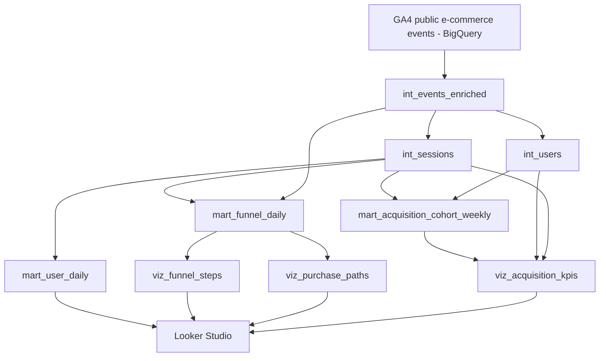

# GA4 E-commerce Analytics | BigQuery & Looker Studio

An end-to-end analytics project built on the public Google Analytics 4 (GA4) e-commerce sample dataset. The project transforms event-level data into reusable analytical models and a three-page dashboard covering business performance, conversion behavior, and customer acquisition and retention.

## Live dashboard

**[Explore the interactive Looker Studio dashboard](https://datastudio.google.com/reporting/7dc6e6e1-0c98-4290-a441-f2e2a8b61a67)**

The dashboard contains three pages:

1. **Business & Customer Performance** — users, sessions, revenue, conversion, and customer segments.
2. **Conversion Funnel** — progression from product view through purchase, including purchases outside the standard funnel.
3. **Acquisition & Retention** — acquisition-channel performance and weekly cohort retention.

## Business questions

- How are traffic, revenue, and conversion changing over time?
- Where do shoppers drop off in the purchase journey?
- Which acquisition channels attract customers who return and generate revenue?

## Selected findings

- **Product discovery is a key funnel bottleneck:** approximately 77K of 360K sessions reached a product view.
- **Not every purchase follows the standard funnel:** approximately 41.5% of purchase sessions occurred outside the fully ordered product-view → cart → checkout → purchase path.
- **Acquisition quality differs by channel:** referral cohorts showed higher revenue per acquired user than paid cohorts in the analysis (approximately $1.40 vs. $0.70).

These observations are descriptive, based on the GA4 sample and the dashboard's modeling choices; they do not establish causality.

## Data architecture



## Repository structure

```text
sql/
├── intermediate/     # Cleaned events, sessions, and users
├── marts/            # Business-ready daily and cohort models
├── quality_checks/   # SQL validation queries
└── views/            # Looker Studio-ready views
```

## Tech stack

- **Google BigQuery / SQL:** event transformation, session modeling, funnel logic, cohort analysis, and validation.
- **Looker Studio:** interactive reporting and business storytelling.
- **GitHub:** versioned SQL and project documentation.

## Data source and scope

- Source: `bigquery-public-data.ga4_obfuscated_sample_ecommerce.events_*`
- Analysis period: **November 1, 2020 – January 31, 2021**
- Dataset: public, obfuscated GA4 sample e-commerce events. Results are illustrative and should not be interpreted as production business performance.

## Data quality and modeling notes

- SQL checks are stored in [`sql/quality_checks/`](sql/quality_checks/).
- The standard purchase funnel requires events to occur in order within a session.
- Cohort denominators repeat across cohort weeks; do not sum `acquired_users` across `week_number`.
- W1/W2 retention metrics use eligibility cutoffs to avoid counting cohorts without enough observation time.

## Explore the SQL

Start with [`sql/intermediate/`](sql/intermediate/) for foundational models, [`sql/marts/`](sql/marts/) for analytical tables, and [`sql/views/`](sql/views/) for dashboard-ready views.
